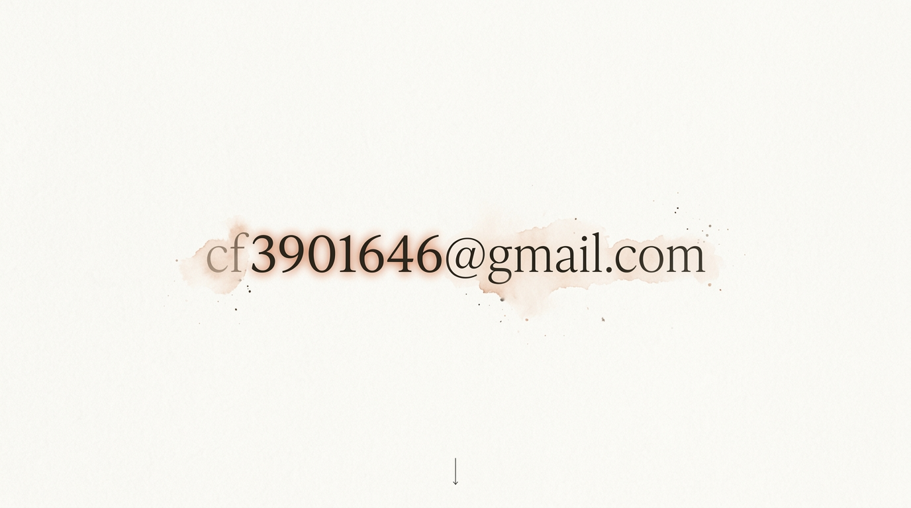
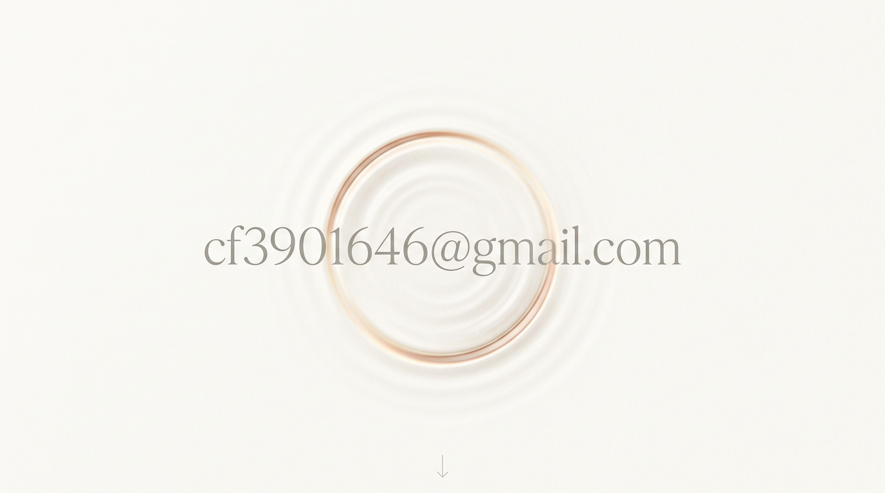
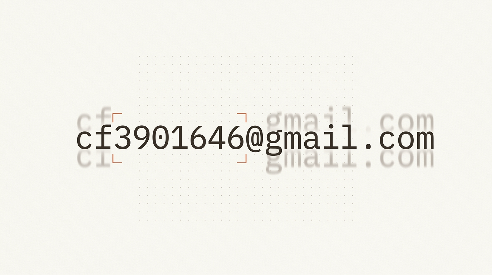

# 3901646.xyz — 午后斜阳与活字压痕的数字花园

> **暖棉信纸为底 · 午后斜阳为韵 · 活字压痕为骨**  
> 域名 **`3901646.xyz`** 与邮箱 **`cf3901646@gmail.com`** 同源呼应的个人数字花园与工具作品集。

---

## ☀️ 核心设计定调（v2.0 钦定基线）

经过深度 `/grill-me` 推演与多版视觉概念比选，网站确立以 **「版本二：午后斜阳 · 活字压痕（Sunlit Archival Paper & Blind Letterpress）」** 作为全站统一的视觉与交互基调：


1. **硬核内核 × 温暖外壳**：
   - **内容内核**：聚焦 **AI 与前沿技术探索**（大模型 / Agent 实践、提示词与自动化工作流、折腾笔记）与 **代表性项目/工具作品集**（独立产品、开源仓库、深度复盘）。
   - **视觉气质**：摒弃冰冷雷同的极客黑底终端风，采用厚实温润的亚麻棉纸质感（`#E6DFD1` 至 `#EFE8DA`）、摇曳的午后斜阳树影（Dappled Gobo Sunlight）、悬浮金色微尘，以及老式活字印刷凹印（Blind Letterpress Deboss）工艺。
2. **第一页（首屏留白序幕）**：
   - 打开 `3901646.xyz`，满屏大片暖色棉纸留白，画面正中央**只放一行凹印邮箱 `cf3901646@gmail.com`**。
   - 当斜阳光束掠过与域名同源的核心数字 **`3901646`** 时，压痕内壁泛起温润的琥珀金边缘高光（Amber Rim-Light）；移动鼠标时光影角度细腻联动，点击即可一键拓印（复制）邮箱。
3. **极简纯静态工作流**：
   - 作品集采用「纯粹图文展厅 ＋ 深度复盘」模式（跳往 GitHub 仓库或站内复盘长文），日常通过本地编写 `.md`（Markdown）＋ `git push` 自动构建发布，零后台维护负担。

---

## 🖼️ 首屏视觉探索全集（Nano Banana 归档）

所有首屏视觉探索原图均归档于 [`assets/designs/`](./assets/designs/) 目录：

| ✅ 钦定主基调（版本二：午后斜阳 · 活字压痕） | 备选探索一（同源破茧 · 水墨显影） |
| :---: | :---: |
|  |  |
| **备选探索三（禅意微澜 · 流体折射）** | **备选探索四（乱码归序 · 算力定格）** |
|  |  |

> 历史 v1.0（「创世者的数字圣殿」五幕概念图 `01_hero_genesis.jpg` 至 `05_contact_portal.jpg`）亦完整保留在 [`assets/designs/`](./assets/designs/) 中供对照参考。

---

## 📄 主站核心设计实现 (`https://3901646.xyz`)

主站首页（`/`）已全面采用最新自包含纯粹原生设计，完全替换淘汰了老版多组件拼接结构：
- **线上正式访问**：[https://3901646.xyz](https://3901646.xyz)
- **主站源码入口**：[`src/pages/index.astro`](./src/pages/index.astro)
- **独立单页备份**：[`./sunlit-letterpress.html`](./sunlit-letterpress.html)（零环境双击即览）
- **静态镜像路由**：`/sunlit-letterpress`（存放于 [`public/sunlit-letterpress.html`](./public/sunlit-letterpress.html)）

**核心特性**：
1. **纯原生自包含**：零网络字体与第三方库依赖，单文件仅 56KB，随时随地双击即览。
2. **程序化物理光影**：Canvas 实时绘制微纤维纸张基底、摇曳日光树影与漫射浮尘微粒。
3. **活字凹印滤镜**：基于 SVG `<feTurbulence>` 与渐变文字裁切，模拟真实凸版印刷凹陷与边缘溢墨。
4. **自然滚动驱动排版**：集成简历/文本排版演化演示（字号、行距、段落与边距随滚动平滑过渡，窄屏自适应平移）。
5. **精细交互组件**：支持修复对比分割滑块、温湿度环境数据可视化图表、三款经典色盘（晨光 / 雨后 / 秋日）实时切换与字距收放调节。

---

## 🛠️ 独立工具全自动部署集群（国内免梯极速直连 · 实时自动拉取）

两大代表工具已与各自的 GitHub 仓库通过 Cloudflare Pages 深度集成独立部署，只要向对应仓库 push 代码即可实时全球生效：
- **EasyCV 简历工作台**：[https://cv.3901646.xyz](https://cv.3901646.xyz)（源码仓库 [`cf3901646/EasyCV`](https://github.com/cf3901646/EasyCV)，纯前端本地渲染、排版微调与 PDF 导出）
- **AITextRestorer 文字修复系统**：[https://restore.3901646.xyz](https://restore.3901646.xyz)（源码仓库 [`cf3901646/AITextRestorer-Web`](https://github.com/cf3901646/AITextRestorer-Web)，纯前端 Canvas / OpenCV 图像文字自适应修复）

---

## 📐 全站页面规划（统一暖阳活字纸感）

| 页面 / 幕次 | 路径与定位 | 视觉与交互延伸 |
| :--- | :--- | :--- |
| **第一页 · 序幕** | `/`（首屏留白） | 满屏暖棉纸 ＋ 斜阳树影微尘 ＋ 中央唯一活字压痕 `cf3901646@gmail.com`（`src/components/Hero.astro`） |
| **第二幕 · 造物展厅** | `/`（滚动展开） | 棉纸发丝网格陈列代表项目（`src/content/projects/*.md`），滚动到达黄金视口自动展开详情与技术标签 |
| **第三幕 · 数字花园** | `/` 列表 ＋ `/posts/[id]` 详情 | 极简书页排版，本地 Markdown 即写即发（`src/content/posts/*.md`），沉淀 Agent 探索与工程实战 |

---

## 🛠️ 本地开发与构建流水线

```bash
# 安装依赖
npm install

# 启动本地开发服务器（http://localhost:4321）
npm run dev

# 静态生产构建（输出至 dist/）
npm run build

# 本地预览构建产物
npm run preview
```

---

## 📁 工程架构与目录组织

```
personal-website/
├── astro.config.mjs          # Astro 5 配置（Tailwind CSS v4 Vite 插件）
├── package.json              # 依赖与脚本（Astro 5 + Tailwind v4 + GSAP）
├── tsconfig.json             # TypeScript 严格模式配置
├── public/
│   └── favicon.svg           # 活字火漆印章 Favicon
├── src/
│   ├── content.config.ts     # Content Collections 强类型校验定义
│   ├── content/
│   │   ├── projects/         # 项目集合（本地 Markdown）
│   │   └── posts/            # 数字花园文章（本地 Markdown，即写即发）
│   ├── layouts/
│   │   └── Layout.astro      # 全站基底骨架 ＋ 物理级棉纸微纤维层
│   ├── components/
│   │   ├── Hero.astro        # 首屏（斜阳光影 ＋ 活字压痕 ＋ 浮尘粒子）
│   │   ├── ProjectList.astro # 造物展厅列表组件（滚动展开抽屉）
│   │   ├── GardenList.astro  # 数字花园文章目录组件
│   │   └── Footer.astro      # 尾注组件
│   ├── pages/
│   │   ├── index.astro       # 首页（GSAP ScrollTrigger 光学联动）
│   │   └── posts/
│   │       └── [id].astro    # 文章独立详情页（动态路由静态生成）
│   └── styles/
│       └── global.css        # Tailwind v4 全局入口 ＋ Design Tokens 色盘
├── docs/                     # 设计文档与访谈蓝图
└── assets/designs/           # 视觉探索原图归档
```
