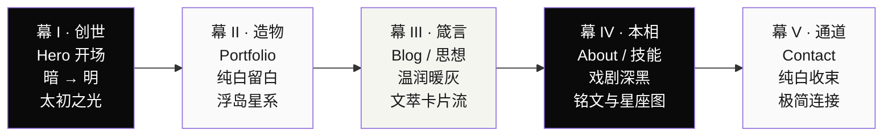
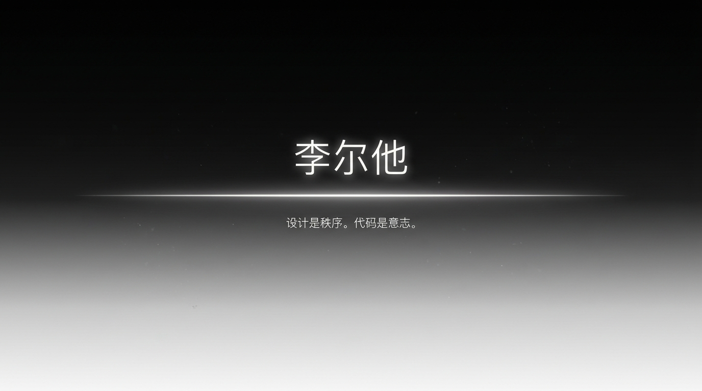
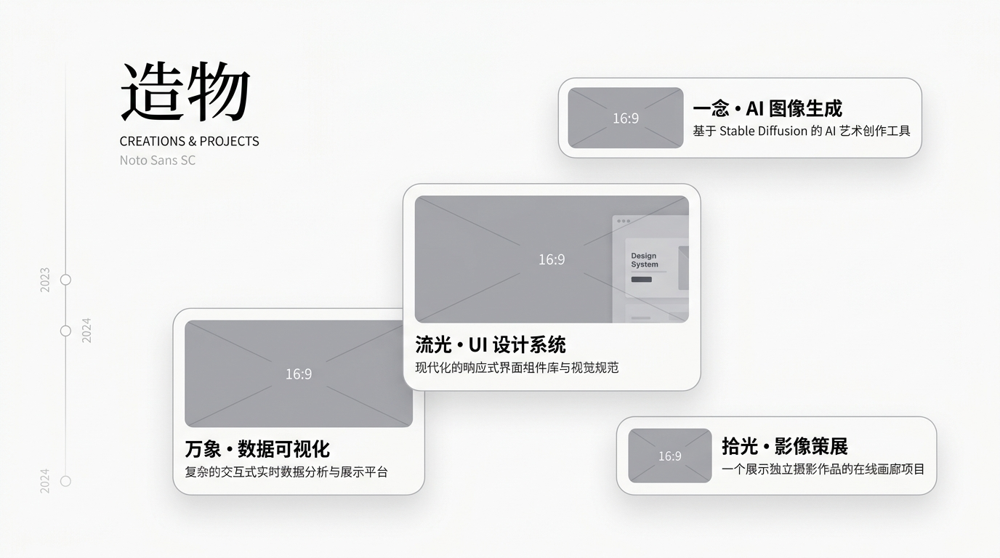
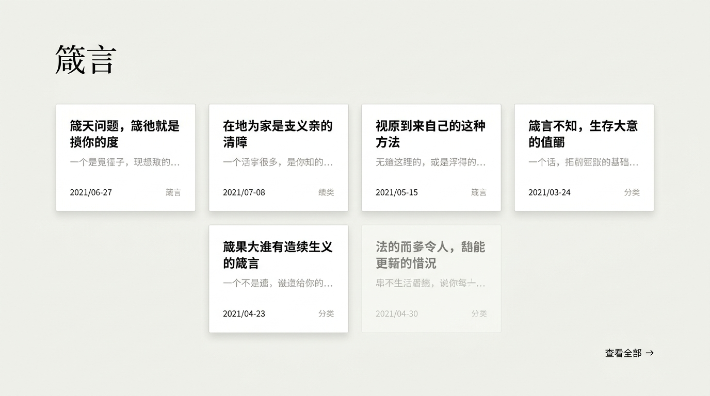
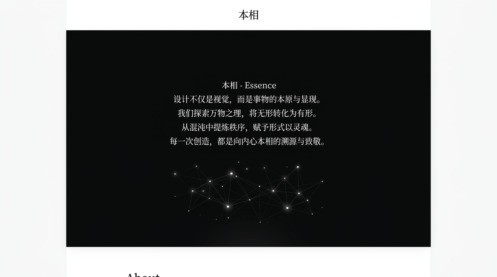
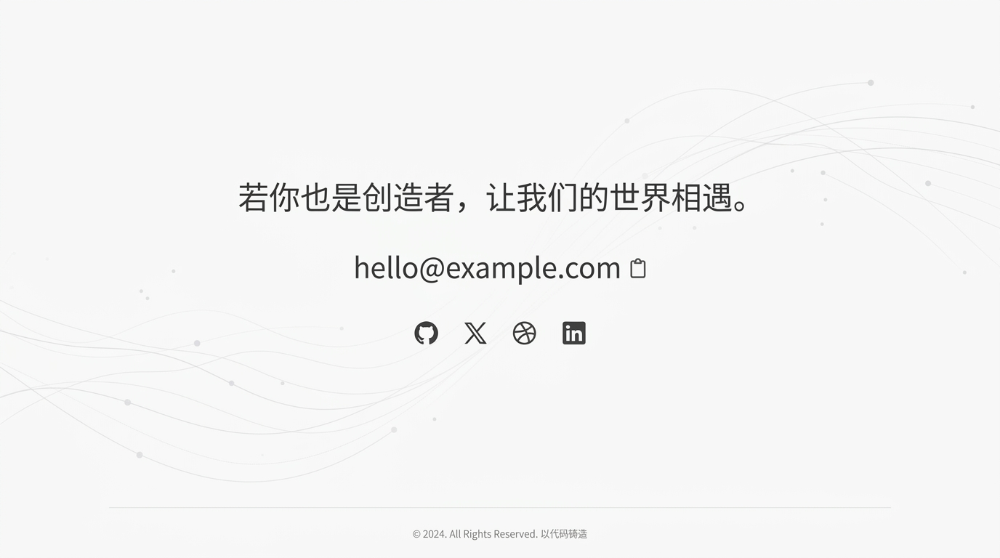

# 创世者的数字圣殿 (The Creator's Sanctuary)

> **极简留白为骨 · 沉浸动画为魂 · 宏大叙事为境**  
> 一位身兼 **UI/UX 设计师** 与 **全栈开发者** 的数字空间作品集与灵感殿堂。

---

## 🌌 项目概述

本项目是一个探索人机界面美学与代码意志表达的个人空间。它打破常规简历式或传统作品集网站的单调结构，以**“创世者与造物”**为隐喻视角，构建一段贯穿五幕的单页滚动互动史诗。

任何在其他设备上拉取本仓库的开发者，可依据本文档体系无缝开展前端工程搭建与交互还原。

---

## 🎬 页面叙事架构（单页五幕剧）

网站整体采用 **Single Page Scroll-Driven** 流式叙事体验，明暗色彩节奏如呼吸般自然交替（`暗 → 明 → 暖 → 暗 → 明`）：

| 章节 | 章节名 | 核心视觉与交互 | 状态氛围 |
| :--- | :--- | :--- | :--- |
| **幕 I** | **创世 (Genesis)** | 黑屏居中绽放一线极细亮光，文字凝结，打字机节奏浮现宣言 | 神圣、开端、专注 |
| **幕 II** | **造物 (Creations)** | 错落浮岛式项目卡片，视差滚动，悬浮 3D Tilt，点击原地展开 Case Study 宇宙 | 沉浸、秩序、立体 |
| **幕 III** | **箴言 (Proverbs)** | 暖灰色调切换，卡片依次上浮（Stagger），优雅排版与技术/设计思考 | 知性、从容、质感 |
| **幕 IV** | **本相 (Essence)** | 全站唯一深黑反差段落，居中铭文逐行点亮，附带发光联结的技能星座星图 | 庄严、内省、力量 |
| **幕 V** | **通道 (Portal)** | 回归纯白，诗意引导短句，一键复制邮箱与极简社交矩阵，首尾呼应 | 平和、回响、连接 |

---

## 🎨 视觉设计原型

设计原型高清图归档于 [`assets/designs/`](./assets/designs/) 目录：

| 幕 I · 创世 | 幕 II · 造物 |
| :---: | :---: |
|  |  |
| **幕 III · 箴言** | **幕 IV · 本相** |
|  |  |
| **幕 V · 通道** | - |
|  | - |

完整原型图解析请参见：[`docs/design-prototypes.md`](./docs/design-prototypes.md)

---

## 📐 设计哲学与规范

1. **虚空生万物**：极致留白不是虚无，而是承载信息的画布。页面避免多余边框与杂乱组件，全屏呼吸感。
2. **克制即力量**：动画缓动推荐使用优雅的 `cubic-bezier(0.16, 1, 0.3, 1)`，元素入场时间控制在 0.8 至 1.2 秒之间。
3. **宏大叙事文风**：杜绝平庸的“我是某某、精通某某”，以造物者的格调传递哲学思考（详见 [`docs/personal-website-blueprint.md`](./docs/personal-website-blueprint.md)）。

---

## 🛠️ 建议实现技术栈（跨设备开发参考）

- **框架选型**：[Next.js 14+ (App Router)](https://nextjs.org/) 或 [Astro](https://astro.build/)
- **核心动效**：[GSAP](https://gsap.com/) + [ScrollTrigger](https://gsap.com/scrolltrigger/)（实现高精度滚动驱动时间轴）
- **组件动画**：[Framer Motion](https://www.framer.com/motion/)
- **样式系统**：Tailwind CSS + CSS Modules
- **内容载体**：MDX / Contentlayer（用于博客“箴言”文章管理）
- **部署平台**：Vercel / GitHub Pages

---

## 📁 文档索引

- 📘 [**完整网站架构蓝图**](docs/personal-website-blueprint.md)：深入拆解五幕机制、色彩排版规范、彩蛋设计与代码架构。
- 🖼️ [**视觉设计原型规范**](docs/design-prototypes.md)：五幕图文对照说明与响应式细节。
- 💬 [**需求讨论纪要与决策链**](docs/interview-transcript.md)：记录从头到尾关于定位、语气、风格与功能的全部推导过程。

---

## 🏷️ GitHub 仓库分类标签 (Topics)

推送到 GitHub 仓库后，请在仓库「About」区配置以下 6 个精准检索标签：
- `portfolio`
- `personal-website`
- `creative-developer`
- `interactive-design`
- `nextjs`
- `gsap`
